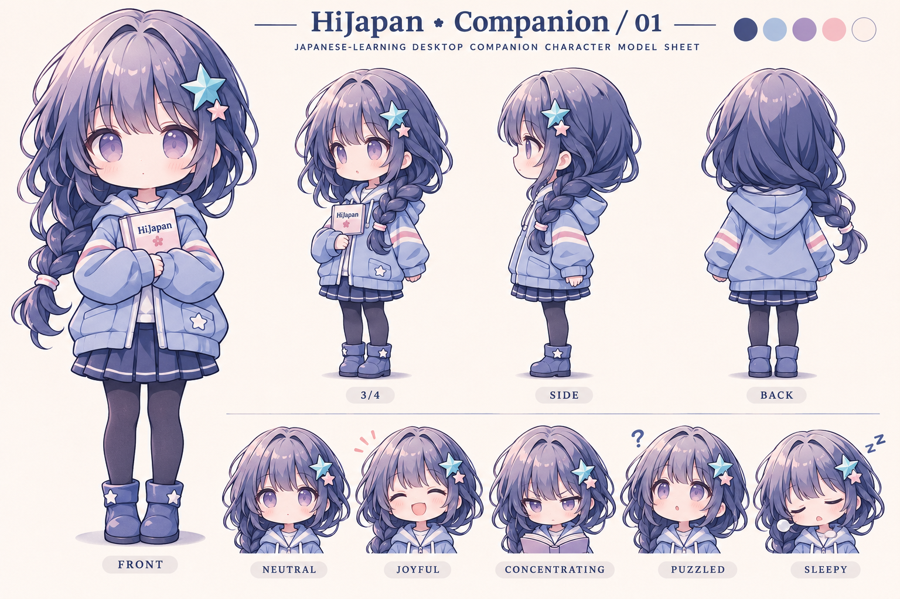
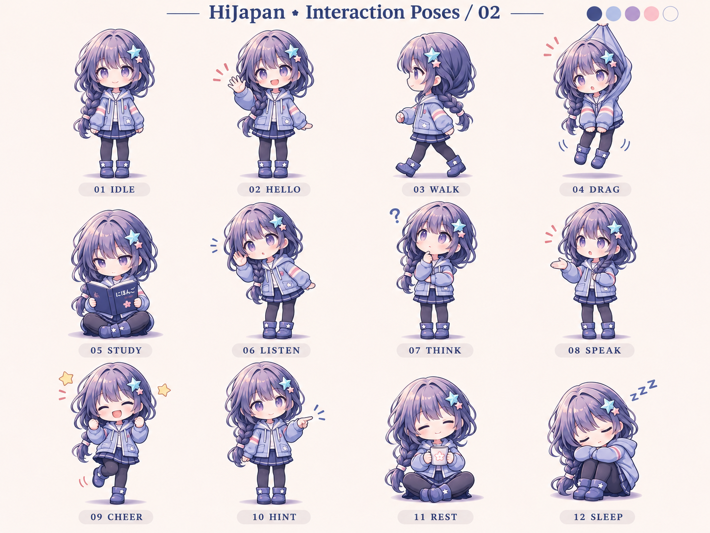

# HiJapan 桌宠视觉与交互设计 v0.1

设计日期：2026-11-09；项目合入日期：2026-11-10。状态：形象与动作设计提案；0.1.7 已接入透明待机立绘与轻量动效，十二种独立姿势的连续动画尚未接入。

## 交付预览

## 形象方向

根据用户提供图片的深蓝发色、紫色眼睛、星饰和浅蓝外套设计 Q 版学习伙伴。约 2.8 头身，保留单侧低辫、青蓝大星与粉色小星组合，简化首饰以适应约 180–240 px 高的桌面显示。当前没有正式角色名，也没有用户确认定稿。

服装以浅蓝连帽外套、粉白袖条、深蓝裙装、深色打底袜、星形短靴为基准。角色正面上，星饰位于画面右侧，辫子位于画面左侧；转向时按角色自身左右延续。禁止用简单镜像代替所有反向动作，以免发饰与辫子换边。

| 文件                          | 用途                                       | 实测规格                         |
| ----------------------------- | ------------------------------------------ | -------------------------------- |
| character-model-sheet-v01.png | 正面、斜侧、侧面、背面及五种表情的设定参考 | 1536 × 1024，不透明背景          |
| interaction-poses-12-v01.png  | 4 列 × 3 行的十二种姿势与表情参考          | 1448 × 1086，不透明背景          |
| idle-transparent-v01.png      | 单独待机立绘，可供后续窗口原型试放         | 1134 × 1387，PNG Alpha 已验证    |
| interactions.json             | 状态 ID、图中位置、触发条件与预期动作时长  | 设计元数据，不是运行时精灵图配置 |
| PROMPTS.md                    | 三次内置图像生成的完整提示词               | 可用于后续修订                   |

## 十二种交互

- **待机（idle）**：桌宠显示且没有其他事件。动作：呼吸、眨眼、辫梢微摆；建议 3–5 秒循环；眨眼随机间隔。
- **挥手（hello）**：软件启动或用户主动打招呼。动作：抬手、左右摆手、收手；建议 1.2–1.8 秒；启动一次。
- **行走（walk）**：用户开启活动模式。动作：起步、左右交替迈步、收步；建议 0.8–1.2 秒步行循环。
- **拖拽（drag）**：鼠标按下并超过拖动阈值。动作：提起、悬空轻摆、落地站稳；建议 跟随拖动；松手后约 0.4 秒回正。
- **学习陪伴（study）**：打开本地课程并选择陪伴。动作：展开笔记、低头阅读、抬眼；建议 4–6 秒安静循环。
- **聆听（listen）**：用户主动开始语音输入（后续实现）。动作：侧耳、轻点头、回正；建议 2–3 秒循环。
- **思考（think）**：用户主动发起的 AI 请求等待中。动作：托腮、抬眼、短暂停顿；建议 1.5–2.5 秒循环；请求结束即退出。
- **讲解（speak）**：系统朗读或用户主动打开说明。动作：抬手、三种口型交替、收手；建议 与实际播放开始/结束同步。
- **鼓励（cheer）**：答对、完成课程或用户点击互动。动作：握拳、轻跳、落地；建议 0.8–1.2 秒；连续答对合并反馈。
- **提示（hint）**：答错后用户选择查看提示。动作：温和指向提示区、停留、收手；建议 1.2–1.8 秒；不责备、不遮题。
- **休息（rest）**：用户主动休息或允许的定时提醒。动作：坐下、捧杯、抬头；建议 4–6 秒循环；提醒可关闭。
- **睡眠（sleep）**：用户手动休眠或设定的静默时段。动作：抱膝闭眼、轻微呼吸；建议 5–7 秒循环；点击唤醒。

## 动画制作交接

两张设定板中的各格是关键姿势，不是连续动画帧；不能直接裁成格子就当动画播放。透明待机图是单张 PNG，也不含眨眼、呼吸或骨骼。下一步需基于定稿角色绘制连续帧，或拆分头发、眼睛、嘴、躯干、手臂做二维骨骼。

建议先完成 idle / hello / drag / cheer / study 五组动作。每组用统一 512 × 640 的透明画布、同一角色比例，脚底锚点建议在 (256, 600)；跳跃与悬空动作保留原地面基线。不同动作之间至少包含起势、主姿势、回正三个阶段。预计 8–12 FPS；具体帧数由节奏确定，不能用复制同一张图充帧。动作循环的首尾应自然衔接。

补绘时保持服装结构、发饰位置、辫子侧向一致，检查 100%、150%、200% Windows 缩放、浅色/深色背景、180 px 与 240 px 高度。当前透明稿的细发边缘和小星饰在缩小时仍需实际验证与可能的修边。

## 交互约束

- 点击提供动作菜单：陪伴学习、发音、对话、休息、隐藏；双击可回到 App。拖动阈值建议 6 CSS px，防止轻触被误判拖拽。
- 拖拽优先于其余动作；松手恢复待机。播放中的朗读由明确的停止入口中断；新题与新课程可以打断鼓励动画。
- 学习中的提示不遮挡选项、输入框或提交按钮；允许锁定位置、暂停移动、静音、关闭气泡和减少动画。
- 休息提醒默认可关闭；连续错误不表现愤怒或责备。无需为角色的情绪制造学习负担。
- 待机、学习、鼓励、提醒、拖拽均由本地事件驱动。AI 只在用户主动使用对话/分析时调用；闲置不产生 API 消耗。聆听动作本身不启动麦克风。
- Think 只跟随实际等待状态；朗读结束切回待机。网络失败显示可关闭的轻提示，不让角色无限等待。

## 验收范围

已经目视检查三张图的构图、全身完整度、姿势差异和主体一致性；已读取 PNG 尺寸，并采样验证透明立绘同时含 Alpha 0 和 Alpha 255。动作规格与元数据状态数为 12。尚未实现悬浮窗口、系统鼠标交互、音频口型同步、连续帧或实际动画验收。

使用内置 image_gen 生成，未调用用户配置的学习 API。三份视觉资产合计约 5.37 MiB。

## 项目合入记录

2026-11-10 已将三张原始 PNG、动作元数据、完整生成提示词与本说明合入 `docs/design/desktop-pet/v0.1/`，并更新根目录开发日志和开发者 README。C 盘原设计包继续保留，项目以此目录为后续设计入口。未合入旧设计包中的权限受限待办说明，以免与实际完成状态混淆。
